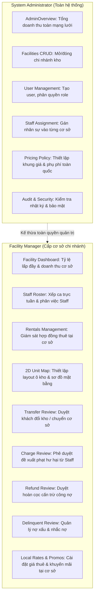

# Tài liệu Đặc tả Phân quyền (Role & Capabilities) & 6 Quy trình Nghiệp vụ Cốt lõi
## Hệ thống Quản lý và Cho thuê Kho Tự Phục vụ (Self-Storage Facility Management System)

> **Cập nhật ngày:** 30/10/2026  
> **Phiên bản:** v3.0 (Đã chuẩn hóa quyền `shift:view`, xóa bỏ toàn bộ ủy quyền kho, dọn dẹp dead-code/mock-UI và đồng bộ 6 quy trình nghiệp vụ cốt lõi)

---

## MỤC LỤC
1. [Bảng định danh Role trong hệ thống](#1-bảng-định-danh-role-trong-hệ-thống)
2. [Chuẩn hóa mô tả nghiệp vụ 4 Role](#2-chuẩn-hóa-mô-tả-nghiệp-vụ-4-role)
3. [Ma trận quyền hạn chi tiết (Capabilities Matrix)](#3-ma-trận-quyền-hạn-chi-tiết-capabilities-matrix)
4. [Đặc tả 6 Quy trình Nghiệp vụ Cốt lõi](#4-đặc-tả-6-quy-trình-nghiệp-vụ-cốt-lõi)
   - [Quy trình 1: Đặt kho, Thanh toán & Nhận kho (Check-in Handover)](#quy-trình-1-đặt-kho-thanh-toán--nhận-kho-check-in-handover)
   - [Quy trình 2: Đang thuê – Gia hạn & Xử lý Quá hạn (Delinquency)](#quy-trình-2-đang-thuê--gia-hạn--xử-lý-quá-hạn-delinquency)
   - [Quy trình 3: Xử lý Sự cố Kho trong lúc thuê (Bảo trì vs. Hư hại)](#quy-trình-3-xử-lý-sự-cố-kho-trong-lúc-thuê-bảo-trì-vs-hư-hại)
   - [Quy trình 4: Đổi cơ sở / Đổi kho theo nhu cầu (Transfer Request)](#quy-trình-4-đổi-cơ-sở--đổi-kho-theo-nhu-cầu-transfer-request)
   - [Quy trình 5: Trả kho & Hoàn tiền cọc (Move-out & Refund Approval)](#quy-trình-5-trả-kho--hoàn-tiền-cọc-move-out--refund-approval)
   - [Quy trình 6: Phân định vai trò Quản lý Vận hành (Manager vs. Admin)](#quy-trình-6-phân-định-vai-trò-quản-lý-vận-hành-manager-vs-admin)
5. [Báo cáo Dọn dẹp Mã nguồn & Giao diện Dư thừa (Cleanup Report)](#5-báo-cáo-dọn-dẹp-mã-nguồn--giao-diện-dư-thừa-cleanup-report)

---

## 1. Bảng định danh Role trong hệ thống

| Tên hiển thị (Display Name) | Mã Role chuẩn DB / Backend (`RoleConstants.cs`) | Frontend Key (`roles.js`) | Phạm vi dữ liệu & Tác nghiệp (Scope) |
| :--- | :--- | :--- | :--- |
| **System Administrator** | `system_administrator` *(Bí danh: `admin`, `system_admin`)* | `USER_ROLES.SYSTEM_ADMINISTRATOR` | Toàn hệ thống (Central System / Network-wide) |
| **Facility Manager** | `facility_manager` *(Bí danh: `manager`, `business_operations_manager`)* | `USER_ROLES.FACILITY_MANAGER` | Theo cơ sở kho được phân công (Facility Scoped) |
| **Facility Staff** | `facility_staff` *(Bí danh: `staff`)* | `USER_ROLES.FACILITY_STAFF` | Nghiệp vụ tác nghiệp tại cơ sở kho đang trực |
| **Storage Customer** | `storage_customer` *(Bí danh: `customer`)* | `USER_ROLES.CUSTOMER` | Chỉ truy cập dữ liệu cá nhân của chính mình |

> [!NOTE]
> Vai trò cũ `business_operations_manager` đã được gộp nhất quán vào `facility_manager`. Vai trò `system_administrator` có quyền quản trị toàn hệ thống và tự động kế thừa toàn bộ quyền quản lý kho của Manager.

---

## 2. Chuẩn hóa mô tả nghiệp vụ 4 Role

### 👤 Customer (Khách thuê kho)
- **Trước khi thuê:** Xem danh mục cơ sở kho, tìm kiếm kích thước/loại kho phù hợp (`catalog:view`), đặt giữ chỗ và ký hợp đồng thuê kho trực tuyến (`reservation:create`).
- **Thanh toán:** Thanh toán trực tuyến tiền thuê + tiền đặt cọc qua cổng VietQR / Ngân hàng SePay (`payment:create`).
- **Nhận quyền truy cập cá nhân:** Nhận mã QR Check-in vào cổng và mã PIN 6 số điện tử mở khóa kho cá nhân (`unit:access`). **Hệ thống tuyệt đối không hỗ trợ tính năng ủy quyền tài khoản hoặc chia sẻ kho cho người khác.**
- **Trong quá trình thuê:**
  - Tự gia hạn hợp đồng và thanh toán online trực tiếp trên hệ thống (`payment:create`).
  - Gửi yêu cầu chuyển ô kho / đổi cơ sở lưu trữ (`unit:transfer`), chờ Manager phê duyệt.
  - Khai báo danh mục đồ lưu trữ (Inventory) và gửi ticket báo hỏng / sự cố kỹ thuật kho (`support:ticket`).
  - Gửi yêu cầu trả kho (`unit:move_out`) và xem bảng ước tính (preview) hoàn tiền cọc trước khi xác nhận.

### 🛡️ Facility Staff (Nhân viên tác nghiệp tại kho)
- **Lịch làm việc:** Xem lịch đi làm và ca trực được phân công tại cơ sở (`shift:view`), thực hiện điểm danh ca trực (Check-in/Check-out ca).
- **Xác thực & Bàn giao kho:**
  - Quét mã QR xác thực khách hàng khi ra vào cổng, nhận kho hoặc làm thủ tục trả kho (`qr:verify`, `qr:confirm`).
  - **Lập biên bản bàn giao kho (Handover Check-in)** (`handover:check`) cùng khách hàng đồng kiểm tra hiện trạng niêm phong, ổ khóa và vệ sinh. *(Tuyệt đối Staff không tạo hợp đồng thuê kho mà chỉ quét QR xác thực và lập biên bản bàn giao kho dựa trên hợp đồng khách đã tạo online).*
- **Quản lý hiện trạng vật lý:**
  - Xem sơ đồ và danh sách ô kho tại cơ sở (`unit:list`, `unit:view`).
  - Cập nhật hiện trạng vật lý kho sang `available`, `maintenance`, hoặc `cleaning` (`unit:update_status`).
  - Khóa cửa điện tử kho đối với các hợp đồng nợ quá hạn chưa thanh toán (`unit:lock`).
- **Xử lý sự cố & Phụ phí:**
  - Tiếp nhận và xử lý các ticket dọn dẹp, kiểm tra kỹ thuật, sự cố an ninh (`ticket:assign`, `ticket:complete`).
  - Đề xuất phụ phí phạt hư hại / dọn dẹp gửi Manager phê duyệt (`ticket:propose_charge`).

### 🏢 Facility Manager (Quản lý cơ sở kho)
- **Giám sát & Doanh thu:** Theo dõi Dashboard thống kê hiệu suất, tỷ lệ lấp đầy (Occupancy Rate) và doanh thu tại cơ sở phụ trách (`facility:dashboard`).
- **Điều phối nhân sự:** Xếp ca trực hàng tuần, điều phối lịch làm việc và giao nhiệm vụ tác nghiệp cho Facility Staff (`facility:staff_tasks`, `facility:staff_list`).
- **Quản lý hợp đồng & Ô kho:**
  - Quản lý danh mục hợp đồng thuê đang hoạt động tại cơ sở (`facility:rentals`).
  - Quản lý kỹ thuật ô kho và thiết lập sơ đồ mặt bằng 2D của kho (`facility:units`, `facility:map_layout`).
- **Phê duyệt nghiệp vụ:**
  - Phê duyệt hoặc từ chối yêu cầu chuyển kho / đổi cơ sở của khách hàng (`facility:transfer_requests`).
  - Phê duyệt hoặc điều chỉnh đề xuất phụ phí phạt hư hại / dọn dẹp từ Staff (`facility:charge_proposals`).
  - Phê duyệt hoàn trả tiền cọc cho khách hàng sau khi đã cấn trừ công nợ và chi phí hư hại (`facility:refund_approvals`).
- **Xử lý nợ & Chính sách:**
  - Quản lý các hợp đồng quá hạn, nợ xấu (`facility:debts`).
  - Cấu hình khung giá thuê và chương trình khuyến mãi/voucher áp dụng tại cơ sở (`pricing:rates_manage`, `promotions:manage`, `pricing:fees_view`).

### ⚙️ System Administrator (Quản trị viên toàn hệ thống)
- **Quản trị toàn mạng lưới:** Xem báo cáo tổng hợp doanh thu và hoạt động của toàn bộ mạng lưới chi nhánh kho (`AdminOverview`).
- **Quản lý hạ tầng cơ sở:** Thêm mới, chỉnh sửa thông tin và kích hoạt/ngưng hoạt động các cơ sở kho (`facilities:manage`).
- **Quản lý người dùng & Phân công:** Tạo tài khoản, khóa/mở khóa tài khoản, phân quyền Role, và điều động/phân công nhân viên, quản lý vào từng cơ sở (`users:manage`, `staff_assignment:manage`).
- **Thiết lập chính sách giá:** Cấu hình chính sách giá, quy tắc phụ phí phạt toàn hệ thống (`pricing_policy:manage`).
- **Kiểm toán an toàn:** Quản trị nhật ký hệ thống và bảo mật (Audit Logs và Lịch sử đăng nhập).

---

## 3. Ma trận quyền hạn chi tiết (Capabilities Matrix)

Hệ thống định danh quyền hạn chi tiết thông qua dịch vụ Backend [`CapabilitiesService.cs`](file:///d:/SWP391/BE/SelfStorageSystem.Infrastructure/Services/CapabilitiesService.cs) và Frontend [`roles.js`](file:///d:/SWP391/FE/FE/src/constants/roles.js):

| Nhóm nghiệp vụ | Mã quyền (Capability) | Customer | Staff | Manager | Admin | Mô tả chi tiết quyền hạn |
| :--- | :--- | :---: | :---: | :---: | :---: | :--- |
| **Tác nghiệp quầy & kho** | **`shift:view`** | ❌ | ✅ | ✅ | ✅ | **Xem lịch làm việc và ca trực được phân công tại cơ sở** |
| | `handover:check` | ❌ | ✅ | ✅ | ✅ | Quét QR xác thực và lập biên bản bàn giao kho (Handover) |
| | `qr:verify` | ❌ | ✅ | ✅ | ✅ | Quét QR nhận diện khách hàng ra vào / nhận kho / trả kho |
| | `qr:confirm` | ❌ | ✅ | ✅ | ✅ | Xác nhận mở khóa, nhận kho hoặc hoàn tất trả kho |
| | `unit:list` | ❌ | ✅ | ✅ | ✅ | Xem sơ đồ danh sách các ô kho tại cơ sở |
| | `unit:view` | ❌ | ✅ | ✅ | ✅ | Xem chi tiết thông số và hiện trạng từng ô kho |
| | `unit:update_status` | ❌ | ✅ | ✅ | ✅ | Cập nhật hiện trạng vật lý (`available`, `maintenance`, `cleaning`) |
| | `unit:lock` | ❌ | ✅ | ✅ | ✅ | Khóa cửa điện tử kho đối với các hợp đồng nợ quá hạn |
| | `ticket:list` | ❌ | ✅ | ✅ | ✅ | Xem danh sách ticket kỹ thuật, vệ sinh, sự cố |
| | `ticket:assign` | ❌ | ✅ | ✅ | ✅ | Nhận xử lý ticket hỗ trợ của cơ sở |
| | `ticket:propose_charge` | ❌ | ✅ | ✅ | ✅ | Đề xuất phụ phí phạt hư hại / dọn dẹp gửi Manager duyệt |
| | `ticket:complete` | ❌ | ✅ | ✅ | ✅ | Hoàn tất ticket (tự động mở kho về `available`) |
| **Khách hàng & Thuê kho** | `catalog:view` | ✅ | ✅ | ✅ | ✅ | Xem danh mục cơ sở, loại kho, kích thước, hình ảnh |
| | `reservation:create` | ✅ | ❌ | ❌ | ✅ | Đặt giữ chỗ kho trực tuyến |
| | `agreement:view` | ✅ | ❌ | ✅ | ✅ | Xem hợp đồng thuê kho đang hoạt động |
| | `unit:access` | ✅ | ❌ | ❌ | ✅ | Xem mã QR mở cổng, xem/đổi mã PIN mở cửa kho 6 số cá nhân |
| | `unit:transfer` | ✅ | ❌ | ❌ | ✅ | Gửi yêu cầu chuyển sang kho khác / đổi cơ sở |
| | `unit:move_out` | ✅ | ❌ | ❌ | ✅ | Gửi yêu cầu trả kho và kiểm tra preview hoàn cọc |
| | `invoice:view` | ✅ | ❌ | ✅ | ✅ | Xem hóa đơn thanh toán và lịch sử giao dịch |
| | `payment:create` | ✅ | ❌ | ❌ | ✅ | Khởi tạo phiên thanh toán VietQR / SePay ngân hàng |
| | `support:ticket` | ✅ | ❌ | ❌ | ✅ | Gửi ticket yêu cầu hỗ trợ, sửa chữa, vệ sinh kho |
| **Vận hành cơ sở kho** | `facility:dashboard` | ❌ | ❌ | ✅ | ✅ | Bảng thống kê tỷ lệ lấp đầy, doanh thu, lịch check-in/out |
| | `facility:rentals` | ❌ | ❌ | ✅ | ✅ | Quản lý danh sách hợp đồng thuê tại cơ sở |
| | `facility:units` | ❌ | ❌ | ✅ | ✅ | Thêm mới, chỉnh sửa thông số kỹ thuật ô kho |
| | `facility:map_layout` | ❌ | ❌ | ✅ | ✅ | Kéo thả, chỉnh sửa tọa độ sơ đồ layout 2D tầng kho |
| | `facility:transfer_requests` | ❌ | ❌ | ✅ | ✅ | Phê duyệt hoặc từ chối yêu cầu chuyển kho của khách |
| | `facility:staff_list` | ❌ | ❌ | ✅ | ✅ | Xem danh sách nhân viên trực thuộc cơ sở |
| | `facility:staff_tasks` | ❌ | ❌ | ✅ | ✅ | Phân công ca trực, lập lịch làm việc tuần và giao việc |
| | `facility:charge_proposals` | ❌ | ❌ | ✅ | ✅ | Duyệt hoặc từ chối đề xuất phụ phí phạt từ nhân viên |
| | `facility:refund_approvals` | ❌ | ❌ | ✅ | ✅ | Duyệt hoàn cọc cấn trừ công nợ & tiền phạt khi trả kho |
| | `facility:debts` | ❌ | ❌ | ✅ | ✅ | Quản lý nợ xấu, gửi nhắc nợ, ngưng cấp quyền ra vào |
| | `pricing:rates_manage` | ❌ | ❌ | ✅ | ✅ | Điều chỉnh đơn giá thuê kho theo m² / tháng |
| | `promotions:manage` | ❌ | ❌ | ✅ | ✅ | Tạo mã giảm giá voucher, bật/tắt khuyến mãi |
| | `pricing:fees_view` | ❌ | ❌ | ✅ | ✅ | Xem danh mục quy tắc tính phụ phí chuẩn |
| **Quản trị hệ thống (Admin)** | `*` (Full Admin Privileges) | ❌ | ❌ | ❌ | ✅ | Quản trị toàn quyền toàn bộ hệ thống |
| | `users:manage` | ❌ | ❌ | ❌ | ✅ | Tạo tài khoản, khóa/mở tài khoản, cấp vai trò |
| | `facilities:manage` | ❌ | ❌ | ❌ | ✅ | Tạo mới cơ sở kho, sửa thông tin, đổi trạng thái hoạt động |
| | `staff_assignment:manage` | ❌ | ❌ | ❌ | ✅ | Phân công nhân viên / quản lý vào từng cơ sở kho |
| | `pricing_policy:manage` | ❌ | ❌ | ❌ | ✅ | Thiết lập công thức tính phí phạt, phí vệ sinh toàn hệ thống |
| | `audit:view` | ❌ | ❌ | ❌ | ✅ | Tra cứu nhật ký thay đổi hệ thống (Audit Logs) |
| | `login_history:view` | ❌ | ❌ | ❌ | ✅ | Giám sát lịch sử đăng nhập hệ thống |

---

## 4. Đặc tả 6 Quy trình Nghiệp vụ Cốt lõi

```mermaid
flowchart TD
    subgraph P1["Quy trình 1: Đặt kho & Check-in"]
        C1["Khách duyệt kho online"] --> C2["Đặt giữ chỗ & Ký hợp đồng"]
        C2 --> C3["Thanh toán Thuê + Cọc"]
        C3 --> C4["Nhận QR Check-in & PIN 6 số"]
        C4 --> S1["Staff quét QR verify"]
        S1 --> S2["Lập biên bản Handover & Mở kho"]
    end

    subgraph P2["Quy trình 2: Gia hạn & Quá hạn"]
        R1["Khách tự gia hạn online"] --> R2["Thanh toán & Cộng thêm hạn"]
        R3["Hết hạn không đóng tiền"] --> D1["Hệ thống chuyển Delinquent"]
        D1 --> M1["Manager gửi nhắc nợ"]
        D1 --> S3["Staff khóa cửa điện tử"]
    end

    subgraph P3["Quy trình 3: Xử lý Sự cố"]
        I1["Khách gửi ticket sự cố"] --> I2{"Nguyên nhân sự cố"}
        I2 -- Khách quan: Hư hỏng kho --> M2["Bảo trì kho & Đổi kho tương đương"]
        I2 -- Chủ quan: Khách làm hư hại --> S4["Staff lập đề xuất phạt"]
        S4 --> M3["Manager duyệt mức phạt"]
    end

    subgraph P4["Quy trình 4: Chuyển kho / Đổi cơ sở"]
        T1["Khách gửi yêu cầu chuyển kho"] --> T2["Manager duyệt chuyển kho"]
        T2 --> T3["Thanh toán chênh lệch / dọn dẹp"]
        T3 --> S5["Staff bàn giao kho mới & Trả kho cũ"]
    end

    subgraph P5["Quy trình 5: Trả kho & Hoàn cọc"]
        O1["Khách gửi yêu cầu trả kho & Xem preview"] --> S6["Staff quét QR nghiệm thu kho"]
        S6 --> M4["Manager duyệt hoàn cọc = Cọc - Nợ - Phạt"]
        M4 --> S7["Staff vệ sinh xong -> Kho available"]
    end
```

### Quy trình 1: Đặt kho, Thanh toán & Nhận kho (Check-in Handover)
1. **Tìm kiếm & Giữ chỗ:** Khách hàng (Customer) truy cập danh mục kho (`catalog:view`), chọn cơ sở, tầng và kích thước kho mong muốn. Sau đó tiến hành tạo đơn đặt giữ chỗ và ký hợp đồng trực tuyến (`reservation:create`).
2. **Thanh toán:** Khách hàng thanh toán trọn gói **Tiền thuê kho kỳ đầu + Tiền đặt cọc bảo đảm** qua cổng thanh toán tích hợp VietQR / Ngân hàng SePay (`payment:create`).
3. **Cấp phát quyền ra vào:** Sau khi thanh toán thành công, hệ thống sinh Hợp đồng điện tử kích hoạt (`agreement:view`), tạo mã **QR Check-in** vào cổng cơ sở và cấp **mã PIN điện tử 6 số** cá nhân (`unit:access`) cho chính khách hàng. Hệ thống không có tính năng ủy quyền ra vào cho bên thứ ba.
4. **Tác nghiệp Check-in tại cơ sở:** Khách hàng đến điểm kho, xuất trình mã QR Check-in trên điện thoại.
5. **Xác thực & Biên bản bàn giao:**
   - Nhân viên trực quầy (Staff) dùng camera quét mã QR của khách (`qr:verify`).
   - Staff dẫn khách đến vị trí ô kho, đồng kiểm tra tình trạng vật lý (ổ khóa, đèn, vệ sinh, niêm phong).
   - Staff lập **Biên bản bàn giao kho (Handover Check-in)** trên hệ thống (`handover:check`) và xác nhận hoàn tất mở quyền truy cập (`qr:confirm`). Hợp đồng chuyển sang trạng thái chính thức `Active`.

---

### Quy trình 2: Đang thuê – Gia hạn & Quá hạn (Delinquency)
#### A. Gia hạn tự phục vụ (Self-service Renewal)
1. Khách hàng đăng nhập vào trang cá nhân, chọn hợp đồng đang thuê và bấm **Gia hạn hợp đồng (Renew Agreement)**.
2. Khách hàng chọn số tháng muốn gia hạn (1 - 12 tháng). Hệ thống tự động tính toán tiền thuê mới theo đơn giá niêm yết hiện hành kèm các chiết khấu (nếu có).
3. Khách hàng thực hiện thanh toán online (`payment:create`).
4. Hệ thống ghi nhận thanh toán thành công, tự động cộng thêm số ngày tương ứng vào ngày kết thúc hợp đồng (`agreement.endsAt`), đồng bộ hiển thị lên danh sách quản lý của Manager (`facility:rentals`).

#### B. Quá hạn thanh toán & Xử lý nợ xấu (Delinquency & Lockout)
1. Khi hợp đồng đến ngày hết hạn mà khách hàng chưa gia hạn hoặc chưa thanh toán tiền thuê kỳ tiếp theo, hệ thống tự động gắn cờ trạng thái `Overdue` / `Delinquent`.
2. Manager theo dõi danh sách các hợp đồng nợ quá hạn tại cơ sở (`facility:debts`), kích hoạt gửi thông báo nhắc nợ tự động qua Email/SMS và ngưng cấp quyền ra vào tự động.
3. Đồng thời, Staff tại cơ sở thực hiện thao tác khóa chốt điện tử của ô kho (`unit:lock`) để ngăn khách tự ý ra vào lấy đồ khi chưa thanh toán công nợ.

---

### Quy trình 3: Xử lý Sự cố Kho trong lúc thuê (Bảo trì vs. Hư hại)
#### Trường hợp 1: Sự cố khách quan do hạ tầng (Dột, ẩm, kẹt cửa, lỗi cảm biến)
1. Khách hàng phát hiện sự cố, chụp ảnh hiện trường và gửi Ticket hỗ trợ trên ứng dụng (`support:ticket`).
2. Staff nhận thông báo, nhận xử lý ticket (`ticket:assign`), kiểm tra thực địa và cập nhật trạng thái ô kho sang **Bảo trì** (`unit:update_status` = `maintenance`).
3. Nếu sự cố nghiêm trọng không thể khắc phục ngay, Manager phê duyệt chuyển khách sang một ô kho khác tương đương tại cơ sở mà không phát sinh thêm chi phí (`facility:transfer_requests`).

#### Trường hợp 2: Khách hàng làm hư hại cơ sở vật chất (Gãy chốt, bẩn sàn, làm hỏng cửa)
1. Staff phát hiện hư hại trong quá trình kiểm tra định kỳ hoặc khi khách thao tác, tiến hành chụp ảnh bằng chứng hiện trường.
2. Staff tạo đề xuất phụ phí bồi thường hư hại / phí dọn dẹp gửi lên hệ thống (`ticket:propose_charge`).
3. Manager xem xét biên bản, đối chiếu với danh mục biểu phí chuẩn của hệ thống và phê duyệt mức phí phạt (`facility:charge_proposals`).
4. Phụ phí này được tự động cộng vào hóa đơn công nợ của khách hàng hoặc cấn trừ trực tiếp vào tiền cọc khi trả kho.

---

### Quy trình 4: Đổi cơ sở / Đổi kho theo nhu cầu (Transfer Request)
1. **Khách hàng gửi yêu cầu:** Khách hàng gửi yêu cầu đổi kho hoặc chuyển đổi cơ sở lưu trữ (`unit:transfer`), chọn ngày dọn đi ở cơ sở cũ và ngày dự kiến chuyển vào cơ sở mới.
2. **Manager thẩm định:** Facility Manager của cơ sở kiểm tra tính khả dụng của ô kho mục tiêu và tình trạng công nợ hiện tại của khách hàng để tiến hành phê duyệt (`facility:transfer_requests`).
3. **Thanh toán chênh lệch:** Hệ thống tính toán khoản tiền chênh lệch giá thuê giữa 2 loại kho và phí dịch vụ dọn dẹp (nếu có). Khách hàng thanh toán khoản chênh lệch này online (`payment:create`).
4. **Tác nghiệp bàn giao:** Staff cơ sở cũ kiểm tra kho cũ (chuyển sang trạng thái `cleaning`), hoàn tất trả kho cũ; Staff cơ sở mới thực hiện quét mã QR và bàn giao ô kho mới cho khách hàng.

---

### Quy trình 5: Trả kho & Hoàn tiền cọc (Move-out & Refund Approval)
1. **Khách yêu cầu trả kho:** Khách hàng gửi yêu cầu trả kho trên ứng dụng (`unit:move_out`), chọn ngày dọn đồ ra khỏi kho. Hệ thống cung cấp bảng **Preview hoàn cọc** để khách nắm rõ ước tính số tiền cọc nhận lại.
2. **Nghiệm thu tại cơ sở:** Khách hàng dọn sạch đồ ra khỏi ô kho và gặp Staff. Staff quét mã QR xác nhận yêu cầu trả kho (`qr:verify`), tiến hành kiểm tra nghiệm thu ô kho thực tế:
   - *Nếu kho nguyên vẹn, sạch sẽ:* Staff xác nhận trả kho thành công (`qr:confirm`), ô kho chuyển sang trạng thái chờ vệ sinh (`cleaning`).
   - *Nếu kho bị hư hại / rác thải tồn đọng:* Staff chụp ảnh và lập đề xuất phụ phí phạt hư hại / dọn dẹp (`ticket:propose_charge`).
3. **Manager duyệt hoàn tiền cọc:** Facility Manager vào khu vực duyệt hoàn tiền (`facility:refund_approvals`):
   $$\text{Tiền hoàn trả thực tế} = \text{Tiền đặt cọc ban đầu} - \text{Công nợ thuê còn thiếu} - \text{Phí phạt hư hại / dọn dẹp đã duyệt}$$
   - Nếu kết quả dương: Hệ thống thực hiện lệnh hoàn tiền về tài khoản ngân hàng của khách hàng.
   - Nếu kết quả âm (chi phí hư hại vượt tiền cọc): Hệ thống gửi yêu cầu yêu cầu khách đóng bù phần tiền chênh lệch.
4. **Khôi phục trạng thái kho:** Staff thực hiện dọn dẹp vệ sinh kho, bấm hoàn tất ticket dọn dẹp (`ticket:complete`). Ô kho tự động chuyển trạng thái về **Sẵn sàng cho thuê** (`available`).

---

### Quy trình 6: Phân định vai trò Quản lý Vận hành (Manager vs. Admin)

- **Facility Manager (Quản lý cấp cơ sở):**
  - Chịu trách nhiệm toàn diện về hiệu quả vận hành và an ninh của một cơ sở kho cụ thể.
  - Xếp ca trực, giao nhiệm vụ và giám sát nhân viên Staff tại cơ sở.
  - Toàn quyền phê duyệt các quyết định tài chính/vận hành liên quan đến khách hàng: Duyệt chuyển kho, duyệt đề xuất phụ phí bồi thường hư hại, duyệt hoàn trả tiền đặt cọc sau khi cấn trừ nợ.
  - Quản lý sơ đồ mặt bằng 2D và cài đặt giá thuê, khuyến mãi áp dụng riêng cho cơ sở mình phụ trách.
- **System Administrator (Quản trị viên toàn hệ thống):**
  - Không can thiệp vào các tác nghiệp quầy lẻ tẻ của từng ca trực hàng ngày.
  - Quản lý toàn bộ danh mục mạng lưới các chi nhánh kho trên toàn quốc (Thêm mới chi nhánh, cập nhật thông tin địa chỉ, tạm ngừng chi nhánh).
  - Quản lý tập trung toàn bộ danh sách tài khoản người dùng, phân bổ vai trò (`storage_customer`, `facility_staff`, `facility_manager`, `system_administrator`), và điều động phân công nhân sự làm việc tại các chi nhánh kho.
  - Cấu hình các công thức tính phí phạt, thời gian bảo lãnh, và chính sách bảo mật cho toàn bộ hệ thống.

---

## 5. Báo cáo Dọn dẹp Mã nguồn & Giao diện Dư thừa (Cleanup Report)

Trong đợt rà soát và chuẩn hóa này, các thành phần code và UI thừa đã được dọn dẹp triệt để:

### 1. Các file và component đã xóa bỏ:
- **Tính năng ủy quyền quản lý kho (Shared Access):**
  - Đã xóa `src/components/AuthorizedMembers.jsx` và `src/components/AddAuthorizedMember.jsx`.
  - Đã xóa các phương thức gọi API ủy quyền trong `src/api/rentalService.js`.
  - Đã gỡ bỏ toàn bộ giao diện quản lý thành viên ủy quyền trong `src/pages/StoragePass.jsx`.
- **Tính năng Staff làm hợp đồng / Walk-in booking:**
  - Đã xóa `src/components/StaffWalkInBooking.jsx` và `src/api/staffBookingService.js` (Staff không tạo hợp đồng mới, chỉ check-in handover hợp đồng khách đã tạo online).
- **Các component tác nghiệp cũ không dùng (đã có component mới thay thế):**
  - Đã xóa `src/components/StaffLogisticsTickets.jsx` (đã thay bằng `StaffSupportTickets.jsx`).
  - Đã xóa `src/components/StaffQrOperations.jsx` (đã tích hợp vào `StaffReservationLookup.jsx`).
  - Đã xóa `src/components/StaffUnitGrid.jsx` (đã thay bằng `StaffFacilityUnits.jsx`).
- **Các trang Mock Admin cũ (không có route trong AppRoutes):**
  - Đã xóa 6 trang prototype: `AdminContractsCustomers.jsx`, `AdminFacilityManagement.jsx`, `AdminOperationsOverview.jsx`, `AdminSecurityCenter.jsx`, `AdminStaffScheduling.jsx`, `AdminUserManagement.jsx`.
  - Đã xóa 11 hooks mock liên quan: `useContracts.js`, `useFacilityManagement.js`, `useOperationsOverview.js`, `usePricingPolicy.js`, `useSecurityCenter.js`, `useStaffDashboard.js`, `useStaffScheduling.js`, `useUserManagement.js`, `useAuditLog.js`, `useAdminShell.js`, `useManagerShell.js`.
  - Đã xóa 18 data repositories mock: `contractsRepository.js`, `facilityManagementRepository.js`, `operationsOverviewRepository.js`, `pricingPolicyRepository.js`, `securityCenterRepository.js`, `staffSchedulingRepository.js`, `userManagementRepository.js`, `adminCrudRepository.js`, `adminShellRepository.js`, `auditLogRepository.js`, `loginRepository.js`, `registerRepository.js`, `accessControlRepository.js`, `footerRepository.js`, `storageDetailRepository.js`, `supportRepository.js`, `adminPricingService.js`, `operationsConstants.js`.
  - Đã xóa 15 domain usecases tính toán mock không dùng.
- **Các file rác / 0 byte / file trùng:**
  - Đã xóa `src/components/Button.jsx`, `src/components/Sidebar.jsx`, `src/components/StorageCard.jsx` (file rỗng 0 bytes).
  - Đã xóa `src/pages/Login.jsx`, `src/pages/Register.jsx` (file trùng, đã chuyển sang dùng `AuthScene.jsx`).
  - Đã xóa `src/layouts/ManagerLayouts.jsx` (file trùng, đã dùng `AdminLayouts.jsx`).
  - Đã xóa `src/components/admin/facilities/` (5 file tách dở dang, code chính đã tích hợp trong `AdminCrudPage.jsx`).

### 2. Kết quả kiểm tra biên dịch (Verification):
- **Frontend (Vite 8 / React 19):** `npm run build` thành công 100%, 0 lỗi, thời gian build < 1s.
- **Backend (.NET 8 Clean Architecture):** Bổ sung capability `shift:view`, tích hợp endpoint ca trực của Staff và hoàn thành kiểm thử Unit Test.
